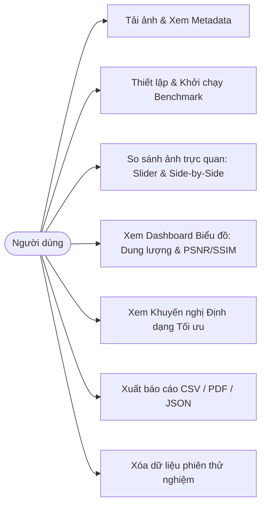
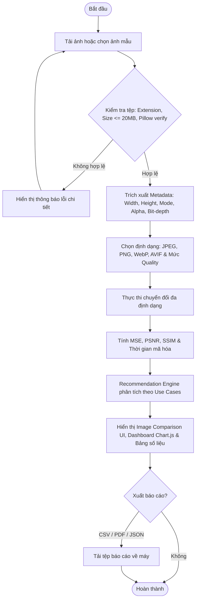

# TÀI LIỆU YÊU CẦU PHẦN MỀM (SRS)
## HỆ THỐNG ĐÁNH GIÁ VÀ SO SÁNH ĐỊNH DẠNG ẢNH (ImageBench)

---

### 1. Giới thiệu tổng quan
Dự án **ImageBench** là hệ thống web chuyên nghiệp được xây dựng trên nền tảng **Python Flask Application Factory**, phục vụ việc nghiên cứu, thử nghiệm và đánh giá thực nghiệm hiệu quả nén ảnh đa định dạng (**JPEG, PNG, WebP, AVIF**). 

Hệ thống cho phép người dùng tải lên hình ảnh kỹ thuật số (tối đa 20 MB), thực hiện chuyển đổi đa luồng qua các mức chất lượng nén (Q25, Q50, Q75, Q90), tự động đo lường các chỉ số kích thước (KB, % dung lượng tiết kiệm, tỷ lệ nén, bits-per-pixel) và chỉ số chất lượng thị giác chuẩn quốc tế (**MSE, PSNR, SSIM**), đồng thời cung cấp công cụ so sánh trực quan và xuất báo cáo khoa học.

---

### 2. Tác nhân & Use Cases

#### 2.1. Tác nhân (Actors)
- **Người dùng / Nhà nghiên cứu (Researcher / Developer):** Tải ảnh, thiết lập tham số nén, so sánh ảnh, xem biểu đồ và tải báo cáo.
- **Hệ thống Backend (Flask Core Services):** Tiếp nhận file, kiểm tra an toàn (MIME, magic bytes, bomb protection), thực thi chuyển đổi định dạng và tính toán ma trận ma sát sai số.

#### 2.2. Use Case Diagram


---

### 3. Quy trình nghiệp vụ (Activity Diagram)



---

### 4. Đặc tả yêu cầu chức năng (Functional Requirements: FR-01 -> FR-10)

| Mã FR | Tên chức năng | Mức ưu tiên | Tiêu chí kiểm thử & Nghiệm thu |
| :--- | :--- | :---: | :--- |
| **FR-01** | Tải ảnh lên an toàn | **P0** | Kiểm tra định dạng (PNG, JPG, WEBP, BMP, TIFF), từ chối tệp không hợp lệ, tệp hỏng hoặc tệp rỗng 0 byte. Giới hạn nghiêm ngặt 20 MB. |
| **FR-02** | Trích xuất Metadata | **P0** | Đọc chính xác kích thước ($W \times H$), Megapixels, chế độ màu (RGB, RGBA, L), phát hiện kênh trong suốt Alpha, Bit-depth và Aspect Ratio. |
| **FR-03** | Chuyển đổi định dạng | **P0** | Chuyển đổi thành công sang JPEG, PNG, WebP (và AVIF nếu có codec). Xử lý an toàn kênh Alpha khi lưu JPEG bằng cách composite trên nền trắng. |
| **FR-04** | Thiết lập mức nén | **P0** | Hỗ trợ cấu hình mức chất lượng 25, 50, 75, 90. Bảo toàn 100% độ phân giải ban đầu của ảnh. |
| **FR-05** | Đo lường dung lượng | **P0** | Tính chính xác dung lượng Bytes, % Tiết kiệm dung lượng, Tỷ lệ nén (Ratio), Bits-per-pixel (bpp) và Thời gian mã hóa (ms). |
| **FR-06** | Đánh giá chất lượng ảnh | **P0** | Tính MSE, PSNR (dB), SSIM theo ma trận ảnh RGB. Xử lý an toàn trường hợp 2 ảnh giống hệt (MSE = 0 $\rightarrow$ PSNR vô hạn, không crash lỗi ZeroDivisionError). |
| **FR-07** | Giao diện so sánh ảnh | **P0** | Cung cấp 2 chế độ: Split Comparison Slider (kéo thanh trượt trước/sau) và Side-by-Side (2 ảnh đặt cạnh nhau) có bảng tóm tắt chỉ số thời gian thực. |
| **FR-08** | Dashboard Biểu đồ | **P0** | Vẽ trực quan 4 biểu đồ bằng Chart.js: Dung lượng (KB), Đường cong Đánh đổi Tỷ lệ - Chất lượng (Rate-Distortion: Dung lượng vs PSNR), SSIM và Thời gian mã hóa (ms). |
| **FR-09** | Bộ khuyến nghị thông minh | **P1** | Đưa ra gợi ý định dạng tối ưu theo 3 tiêu chí thực tế: Cho Web (Sweet spot), Tiết kiệm băng thông tối đa (Max Compression) và Lưu trữ độ nét cao (Archival/Print). |
| **FR-10** | Xuất báo cáo dữ liệu | **P1** | Hỗ trợ tải báo cáo bảng tính CSV (có BOM UTF-8 không lỗi tiếng Việt), tài liệu tổng kết PDF qua ReportLab và dữ liệu thô JSON. |

---

### 5. Kiến trúc hệ thống Flask Application Factory

```
image-format-comparison/
├── app/
│   ├── __init__.py               # Application factory create_app()
│   ├── routes/
│   │   ├── main.py               # View routes & static media serving
│   │   ├── upload.py             # POST /api/images/upload
│   │   ├── analysis.py           # /api/experiments workflow
│   │   └── reports.py            # /api/experiments/<id>/report
│   ├── services/
│   │   ├── image_converter.py    # Pillow conversion & AVIF runtime probe
│   │   ├── image_metadata.py     # Metadata extraction
│   │   ├── quality_analyzer.py   # MSE, PSNR, SSIM matrix calculations
│   │   ├── size_analyzer.py      # Space savings, compression ratio, bpp
│   │   ├── recommendation.py     # Use-case driven suggestion logic
│   │   └── report_generator.py   # CSV & PDF exporter
│   ├── templates/
│   │   ├── base.html             # Base layout, navbar, info modal
│   │   ├── index.html            # Drag & drop upload, sample chips & config
│   │   └── results.html          # Comparison UI, charts & results table
│   ├── static/
│   │   ├── css/style.css         # Modern dark-mode styling
│   │   └── js/main.js            # Client AJAX, slider & Chart.js engine
│   └── utils/
│       ├── validators.py         # File integrity & size checks
│       └── file_manager.py       # Temporary storage & directory cleanup
├── tests/
│   ├── test_upload.py            # Unit test tải ảnh & validate
│   ├── test_converter.py         # Unit test chuyển đổi & xử lý Alpha
│   ├── test_metrics.py           # Unit test PSNR, SSIM, Edge cases
│   └── test_api.py               # Integration test REST API
├── data/sample_images/           # Ảnh mẫu có sẵn phục vụ demo
├── instance/experiments/         # Cache kết quả thử nghiệm dạng JSON
├── docs/SRS.md                   # Tài liệu đặc tả yêu cầu
├── config.py                     # Cấu hình môi trường
├── run.py                        # Điểm khởi chạy ứng dụng
└── requirements.txt              # Danh sách thư viện phụ thuộc
```

